<picture>
  <source media="(prefers-color-scheme: light)" srcset="./assets/banner-light.svg" />
  
</picture>

CS student in Switzerland, focused on backend development.

**Into:** software architecture · OOP · design patterns · logical problem solving

### Work

| Project | | Stack |
|---|---|---|
| **Legacy → REST API** | REST API extracted from a legacy Django monolith, without breaking production. | Django · DRF |
| **[Quote Generator](https://github.com/Mrck-Kvs/quote-generator)** | Branded PDF quotes for service businesses. Used in production by a renovation company. | PHP · Tailwind |
| **[school-labs](https://github.com/Mrck-Kvs/school-labs)** | C# / WPF coursework. | C# · WPF |

### Stack

 
 

<i>“Whatever you do, work at it with all your heart.” — Colossians 3:23</i>

